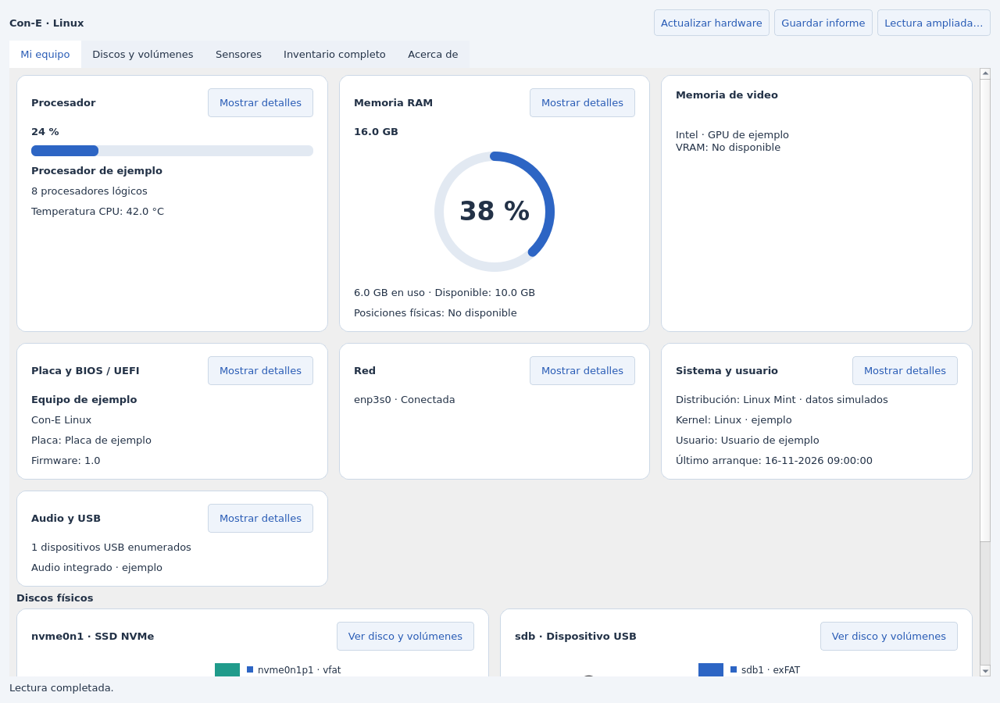

# Con-E Linux v0.1.0 — primera versión de prueba
Diagnóstico gráfico de hardware para **Ubuntu 22.04/24.04 y Linux Mint 21/22 de 64 bits x86-64**. La compatibilidad con Mint en equipos físicos debe comprobarse con esta versión de prueba.

[Descargas de prueba](https://github.com/momocrackcorp/Con-e/releases/tag/con-e-linux-v0.1.0) · [Con-E para Windows](../README.md)

## Incluye
- CPU: modelo, núcleos/hilos informados, arquitectura, uso y frecuencias disponibles en el inventario.
- RAM: capacidad y ocupación; módulos SMBIOS cuando la lectura ampliada puede consultarlos.
- GPU: dispositivos PCI, VRAM cuando el equipo la expone y lecturas NVIDIA si existe nvidia-smi.
- Discos físicos, pendrives y volúmenes descendientes, incluidos dispositivos cifrados/LVM que lsblk enumere; formatos, montajes y espacio usado/libre cuando son consultables.
- Miniaturas HDD, SSD, M.2 NVMe y USB; NVMe no demuestra el formato físico M.2.
- Anillo de uso y análisis de carpetas de la raíz, a petición y cancelable. No lista archivos individuales.
- Temperaturas, ventiladores y mínimos/máximos de la sesión cuando Linux expone sensores.
- Placa, BIOS/UEFI, red, audio y dispositivos PCI/USB.
- Datos del sistema, usuario y último arranque; fecha de instalación como No disponible si no existe una fuente fiable.
- Informe JSON y Acerca de con la ilustración original de Coné y los créditos de Omar Águila / Laboratorios Momocrackcorp.

No contiene operaciones de particiones, actualizador de programas ni gestión de controladores.

## Probar con instalador .deb
Descarga `con-e-linux_0.1.0_amd64.deb`, ábrelo con el instalador de paquetes de Ubuntu/Mint y busca **Con-E Linux** en el menú.

También puedes instalarlo desde la carpeta de descarga:
```bash
sudo apt install ./con-e-linux_0.1.0_amd64.deb
```

El instalador resuelve bibliotecas del sistema. El uso normal de Con-E no requiere sudo ni descargar Python: el paquete incluye su entorno.

## Probar el paquete portátil
1. Descarga `Con-E-Linux-v0.1.0-x86_64.tar.gz`.
2. Extrae el archivo completo.
3. Abre `Con-E-Linux/Iniciar-Con-E.sh` o ejecuta:
```bash
./Con-E-Linux/Iniciar-Con-E.sh
```

Conserva `_internal` junto al ejecutable. El sistema necesita las bibliotecas gráficas de Qt/X11/EGL incluidas como dependencias del .deb. Si falta una, utiliza preferentemente el instalador .deb. El paquete portátil no utiliza FUSE.

## Lectura ampliada
El botón solicita autorización mediante polkit/pkexec, sólo después de una confirmación explícita. Consulta **dmidecode** y **smartctl** en modo lectura. No instala herramientas ni modifica discos. Si están ausentes, la lectura informa esa limitación. Puedes instalarlas con el gestor de paquetes del sistema.

El helper se ejecuta por separado de la interfaz; usa comandos fijos sin shell. En la versión fuente, no ejecutes código de procedencia desconocida como administrador.

Los datos SMART corresponden al dispositivo físico. Se muestran sólo cuando se puede asociar la serie del inventario con la serie de la lectura. No se inventan salud, porcentajes ni contadores; una lectura SMART no garantiza ausencia de fallos.

## Análisis de carpetas
Sólo recorre metadatos dentro del sistema de archivos seleccionado: omite enlaces simbólicos, otros montajes y rutas sin acceso. Cuenta enlaces duros una vez y utiliza bloques asignados para evitar contar el tamaño aparente de archivos dispersos. Los porcentajes del gráfico son sobre lo leído, no una afirmación de haber contabilizado todo el volumen. No cambia, borra ni abre el contenido de los archivos.

No monta volúmenes, no desbloquea cifrado y no lee automáticamente un disco no montado.

## Compilar desde el repositorio
```bash
sudo apt install python3-venv python3-tk pciutils usbutils
python3 -m venv .venv
. .venv/bin/activate
pip install -r Linux/requirements.txt
python Linux/app.py
```

Para generar paquetes, consulta el flujo `.github/workflows/linux.yml`. Se construye en Ubuntu 22.04 x86-64. El paquete fuente incluido conserva los scripts, requisitos y recursos gráficos.

## Autoría y derechos
Desarrollada por **Omar Águila**, en **Laboratorios Momocrackcorp**, **noviembre de 2026**, **Pueblo Seco, San Ignacio, Ñuble, Chile**.

Con-E hace un guiño a Coné, sobrino de Condorito, personajes creados por René Ríos Boettiger, Pepo. Los derechos sobre los personajes, nombres e ilustraciones pertenecen a sus respectivos titulares. No se afirma afiliación, patrocinio o licencia concedida. Las dependencias conservan sus licencias, incluidas en el paquete y en THIRD_PARTY_NOTICES.md.

## Validación
Pruebas de parsers, datos desconocidos, SMART, cancelación y análisis de archivos temporales con enlaces duros y simbólicos. Capturas de interfaz con datos simulados y prueba del ejecutable empaquetado. La compatibilidad física con sensores, firmware y polkit debe comprobarse en tu equipo.


